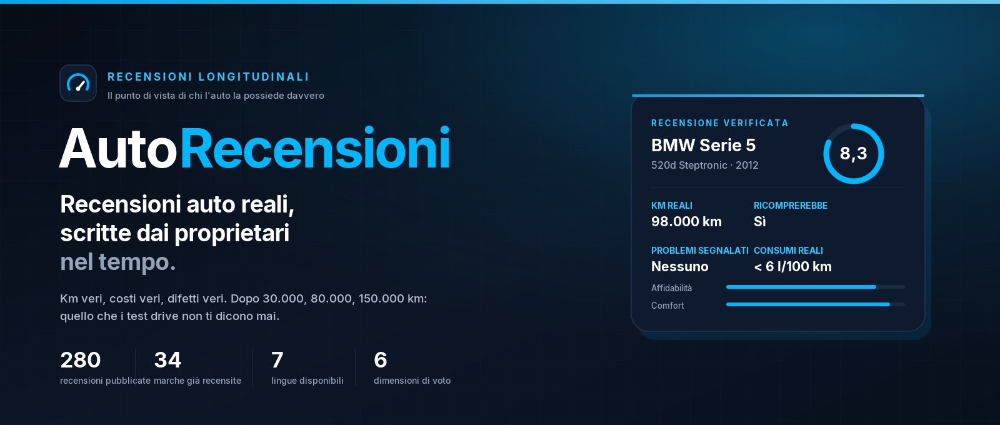
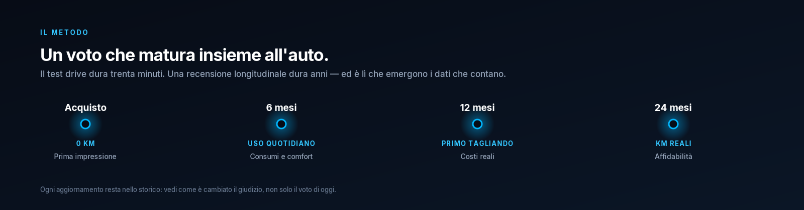
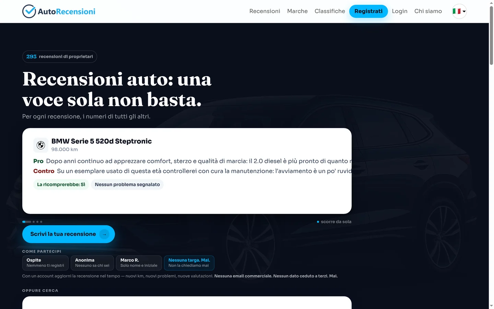
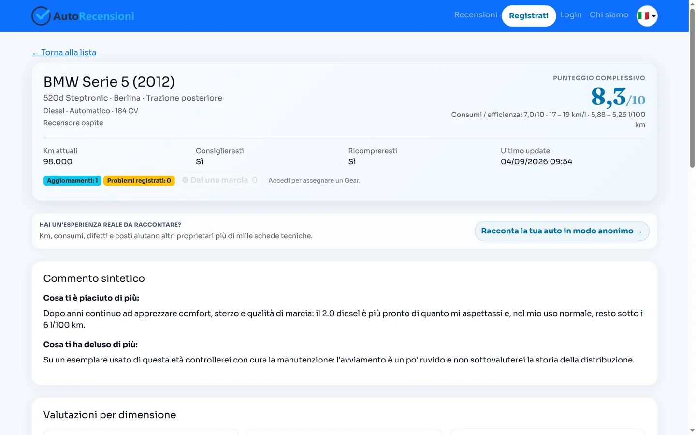
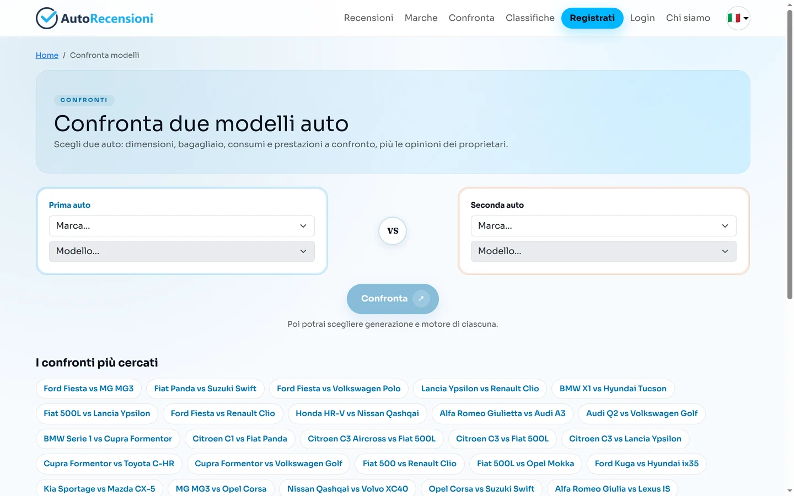
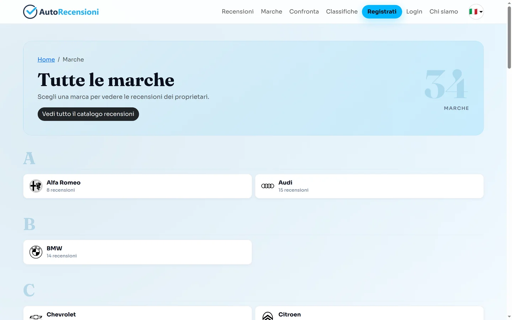
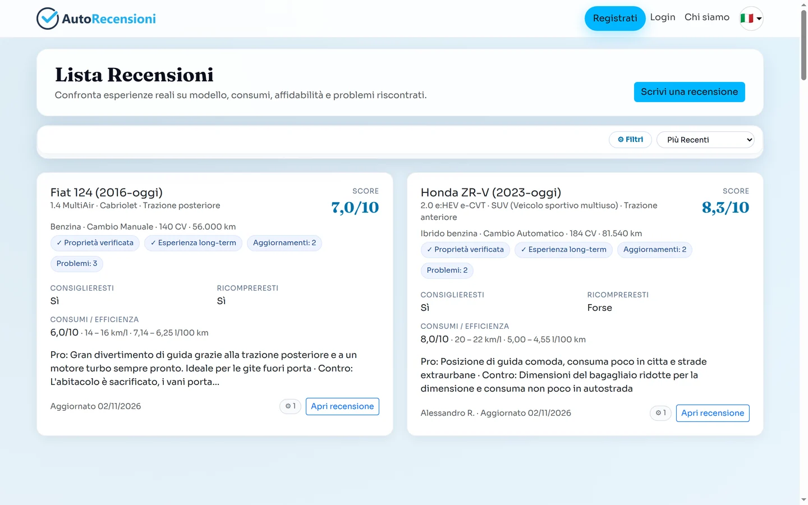
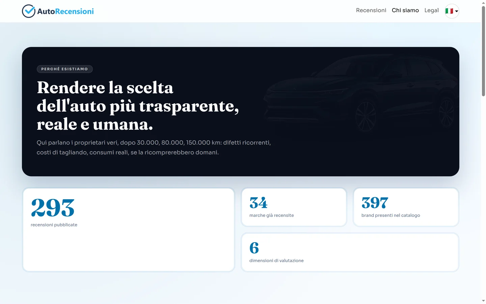

  

<h3 align="center">La voce di chi l'auto la possiede davvero.</h3>

  <a href="https://www.autorecensioni.it/"><b>🌐 Sito</b></a> ·
  <a href="https://www.autorecensioni.it/reviews/"><b>Leggi le recensioni</b></a> ·
  <a href="https://www.autorecensioni.it/reviews/start/"><b>Scrivi la tua</b></a> ·
  <a href="https://www.autorecensioni.it/confronti/"><b>Confronta modelli</b></a> ·
  <a href="https://www.autorecensioni.it/chi-siamo/"><b>Chi siamo</b></a> ·
  <a href="https://www.autorecensioni.it/legal/privacy-policy/"><b>Privacy</b></a>

---

## Un progetto, non un software

AutoRecensioni è un sito web e una community di proprietari, non un'app da installare. Questo repository non contiene il codice del sito e non è pensato per essere clonato e avviato: è la **presentazione pubblica dell'idea**, di ciò che è già online e di ciò che possiamo costruire insieme.

Se sei arrivato qui cercando "come si installa", la risposta è: non si installa. Si usa, si legge, si alimenta scrivendo la propria esperienza — e si può aiutare a farlo crescere.

## Il problema

Chi compra un'auto — nuova o usata — prende una delle decisioni più costose della sua vita con informazioni pensate per vendere, non per durare. I test drive durano mezz'ora. Le recensioni online sono spesso un voto a stelle senza contesto. I forum hanno esperienze vere, ma sparse e impossibili da confrontare.

E nessuno racconta la cosa più importante: **come invecchia quell'auto**. I consumi dopo due inverni, il tagliando fuori garanzia, il difetto che si manifesta a 90.000 km, se dopo tre anni la ricompreresti.

## Analisi: dove si rompe l'informazione

| Fonte | Quando parla | Cosa sa | Cosa manca |
|---|---|---|---|
| Test drive e stampa | Prima dell'acquisto | Tutto della vettura appena uscita | Usura, costi reali, difetti che emergono vivendo l'auto |
| Recensioni a stelle | Subito dopo l'acquisto | L'entusiasmo — o la delusione — del momento | Struttura, aggiornamento, comparabilità tra modelli |
| Forum e gruppi social | Anni dopo, per caso | Esperienze appassionate e isolate | Dati aggregati, verificabili, confrontabili |
| **AutoRecensioni** | 6, 12, 24 mesi | Km reali, costi, problemi ricorrenti, ricomprabilità | — |

### Le tre conclusioni dell'analisi

**1. Il dato che manca è il tempo.** Un'auto non si giudica in un pomeriggio: si giudica dopo due inverni, un tagliando fuori garanzia e decine di migliaia di chilometri. Il tempo è l'unica variabile che nessun test drive può comprimere.

**2. Le opinioni libere non si confrontano.** Un post su un forum è prezioso, ma non è aggregabile: manca l'unità di misura. Se ogni recensione usa campi diversi, non puoi rispondere a "questa versione, a questo chilometraggio, quanto mi costerà?". Servono dati strutturati.

**3. Chi compra usato è il più esposto e il meno servito.** L'usato è il mercato più grande e quello con più rischio nascosto — ma l'informazione disponibile è pensata per il nuovo. È esattamente lì che una recensione longitudinale cambia la decisione.

## L'idea: il tempo come unità di misura

Ogni recensione nasce da campi strutturati — non da un post libero — e viene **aggiornata nel tempo**: dopo 6 mesi, un anno, due anni. Ogni aggiornamento è uno snapshot con voti, km, costi e problemi: il voto mostrato è l'ultimo, ma lo storico resta leggibile. Non è un'istantanea del giorno dell'acquisto, è la storia di come l'auto è invecchiata.

  

| Cosa misuriamo | Perché conta |
|---|---|
| **Km e mesi reali** | Ogni giudizio è ancorato al chilometraggio e al tempo di possesso |
| **6 dimensioni di voto** | Affidabilità, comfort, piacere di guida, praticità, costi, consumi |
| **Costi di possesso** | Tagliandi, gomme e riparazioni fuori garanzia, non il listino |
| **Ricomprabilità** | La domanda che conta: dopo averla vissuta, la ricompreresti? |
| **Problemi ricorrenti** | I difetti che emergono solo con l'uso, aggregati per modello |

## Cosa può fare chi cerca un'auto

- **Cercare il modello che interessa** — per marca, modello, versione, anno e alimentazione: [catalogo marche](https://www.autorecensioni.it/marche/).
- **Confrontare due auto** fianco a fianco, con voti, costi e problemi dichiarati dai proprietari: [confronti](https://www.autorecensioni.it/confronti/).
- **Leggere i problemi noti prima di comprare** — la scheda "cosa guardare" nasce dalle segnalazioni reali, ad esempio [BMW Serie 5](https://www.autorecensioni.it/marche/bmw/serie-5/problemi/).
- **Fare una domanda concreta**: "questa versione, a questo chilometraggio, con questi costi" — non "è bella?".

## Cosa può fare chi possiede l'auto

- **Raccontare la propria esperienza** — anche in forma anonima, senza account: [scrivi la tua recensione](https://www.autorecensioni.it/reviews/start/).
- **Tornare ad aggiornarla** a 6, 12 e 24 mesi: è il contributo che nessun altro può dare.
- **Segnalare un problema ricorrente** perché diventi un dato utile per chi comprerà quell'auto domani.
- **Chiedere il badge *Proprietà verificata***: basta una dichiarazione, senza targa, telaio o documenti.
- **Segnalare un contenuto illecito**: [canale dedicato](https://www.autorecensioni.it/legal/report-illegal-content/).

## Cosa possiamo fare insieme

Queste sono le direzioni in cui il progetto può crescere. Non sono promesse di prodotto: sono lavori aperti a chi vuole darci una mano.

- **Una mappa dei problemi per modello.** Trasformare le segnalazioni sparse in "cosa si rompe, a che chilometraggio, quanto costa ripararlo".
- **Il confronto sull'usato.** Oggi si confrontano le schede tecniche; domani si dovrebbero confrontare le storie: a 100.000 km, quale delle due mi costerà meno?
- **Più lingue, più proprietari.** Il sito è già in 7 lingue: la prossima frontiera è raccogliere esperienze in quei mercati, non solo tradurre l'interfaccia.
- **Un patto di trasparenza.** Nessuna recensione a pagamento, nessun produttore che compra visibilità: se il progetto cresce, questa regola non si tocca.
- **Ambasciatori, non influencer.** Chi ha un'auto e un'esperienza vera vale più di cento post sponsorizzati.

Se una di queste direzioni ti interessa, [scrivici](mailto:info@autorecensioni.it): le idee migliori di solito arrivano da chi usa il sito.

## Cosa non è

Non è un catalogo di auto. Non è una rivista. Non è un comparatore di prezzi. Non è finanziato da case automobilistiche o concessionari, e non vende posizioni, punteggi o pubblicità. **Se un modello ha problemi noti, li leggi.**

## Il progetto in numeri

- **280** recensioni pubblicate da proprietari
- **34** marche già recensite
- **7** lingue disponibili (IT · EN · DE · FR · ES · PT · NL)
- **6** dimensioni di valutazione per ogni vettura
- **0** recensioni a pagamento

## Il sito

  

  
  

  
  

Oltre alle recensioni, il sito offre **pagine marca e modello** con dati aggregati, **confronti A-vs-B** tra due vetture, **classifiche** per categoria e **schede "cosa guardare prima di comprare"** costruite sui problemi segnalati dai proprietari.

## Privacy e dati

La privacy non è una pagina in fondo al sito: è una scelta di prodotto. Ecco cosa succede ai tuoi dati, in chiaro.

| Cosa raccogliamo | Perché | Per quanto |
|---|---|---|
| E-mail e password (cifrata) | Creare l'account e farti accedere | Fino alla cancellazione + 30 giorni di backup |
| Dati del profilo (facoltativi) | Personalizzare il profilo pubblico | Fino alla cancellazione |
| Dati del veicolo e recensione | Pubblicare l'esperienza e calcolare i voti | Fino alla cancellazione della recensione |
| IP dell'invio come ospite | Prevenire abusi e recensioni duplicate | 6 mesi, cancellato prima se colleghi la recensione all'account |
| Log tecnici (IP, accessi) | Sicurezza e diagnostica | 12 mesi |
| Analytics | Statistiche aggregate d'uso | Solo con consenso esplicito, revocabile in ogni momento |

- **Niente targa, niente telaio, niente documenti.** La verifica di proprietà è una dichiarazione: non chiediamo né conserviamo targhe, libretti o altri documenti del veicolo.
- **Decidi tu quanto mostrare.** Puoi pubblicare in forma anonima o da ospite: il nome visualizzato è una tua scelta, non un obbligo.
- **Nessuna vendita, cessione o affitto a terzi.** Nessun cookie pubblicitario, nessuna profilazione per advertising, nessun data broker.
- **Analytics solo dopo un consenso esplicito**, con la stessa facilità di revoca con cui è stato dato.
- **Fornitori tecnici solo per far funzionare il servizio** (hosting, e-mail transazionali, autenticazione Google): nominati responsabili del trattamento ai sensi dell'art. 28 GDPR. I trasferimenti extra-UE avvengono con Clausole Contrattuali Standard.
- **Hai tutti i diritti del GDPR** (artt. 15–22): accesso, rettifica, cancellazione, limitazione, portabilità, opposizione. Risposta entro 30 giorni; reclamo al [Garante](https://www.garanteprivacy.it/).
- **Titolare del trattamento**: Alessandro Rellecati — [info@autorecensioni.it](mailto:info@autorecensioni.it).

  <a href="https://www.autorecensioni.it/legal/privacy-policy/"><b>Privacy Policy</b></a> ·
  <a href="https://www.autorecensioni.it/legal/cookie-policy/"><b>Cookie Policy</b></a> ·
  <a href="https://www.autorecensioni.it/legal/terms/"><b>Termini</b></a> ·
  <a href="https://www.autorecensioni.it/legal/review-guidelines/"><b>Linee guida recensioni</b></a> ·
  <a href="https://www.autorecensioni.it/legal/report-illegal-content/"><b>Segnala contenuto illecito</b></a>

## Chi siamo

  

> *Rendere la scelta dell'auto più trasparente, reale e umana.* Qui parlano i proprietari veri, dopo 30.000, 80.000, 150.000 km: difetti ricorrenti, costi di tagliando, consumi reali, se la ricomprerebbero domani.

## Dove vogliamo arrivare

- **Coprire il mercato usato reale**, non solo i modelli nuovi: le auto che si comprano davvero hanno 80.000–200.000 km.
- **Rendere il tempo un dato di prodotto**: aggiornamenti a 6/12/24 mesi come standard, non come eccezione.
- **Dare a chi compra una risposta, non una classifica**: "questa versione, a questo chilometraggio, con questi costi".
- **Crescere in Europa** mantenendo la stessa regola: parlano solo i proprietari.
- **Restare indipendenti**: nessun produttore, concessionario o inserzionista può comprare visibilità o punteggi.

## Partecipa

- **Sito**: [www.autorecensioni.it](https://www.autorecensioni.it/)
- **Scrivi la tua recensione**: [autorecensioni.it/reviews/start](https://www.autorecensioni.it/reviews/start/)
- **Leggi le recensioni**: [autorecensioni.it/reviews](https://www.autorecensioni.it/reviews/)
- **Marche**: [autorecensioni.it/marche](https://www.autorecensioni.it/marche/)
- **Confronti**: [autorecensioni.it/confronti](https://www.autorecensioni.it/confronti/)
- **Chi siamo**: [autorecensioni.it/chi-siamo](https://www.autorecensioni.it/chi-siamo/)
- **Instagram**: [@autorecensioni.it](https://www.instagram.com/autorecensioni.it/)
- **Facebook**: [autorecensioni.it](https://www.facebook.com/autorecensioni.it/)
- **Contatti**: [info@autorecensioni.it](mailto:info@autorecensioni.it)

---

  © 2026 AutoRecensioni — Tutti i diritti riservati. Codice e contenuti proprietari. 
  Made with passion in Italy 🇮🇹

